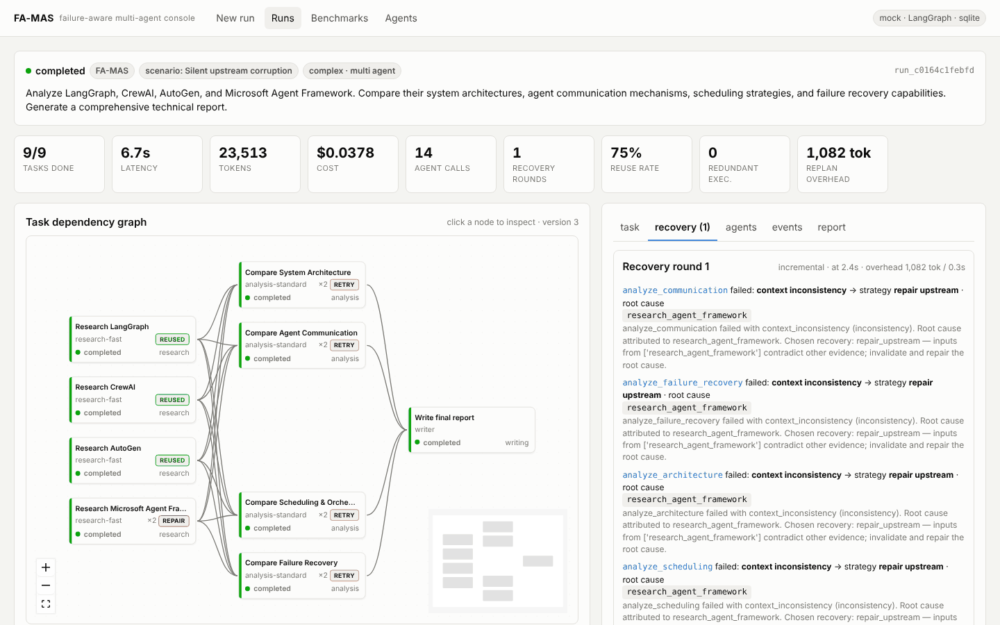
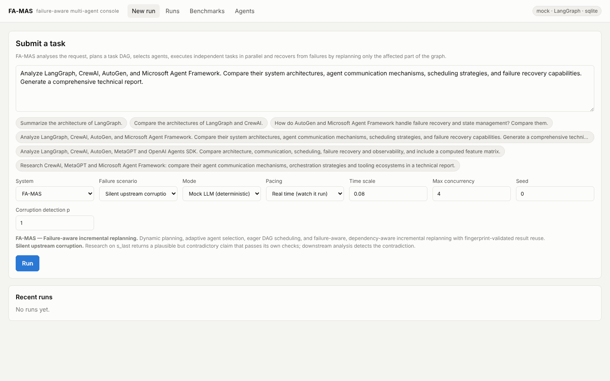
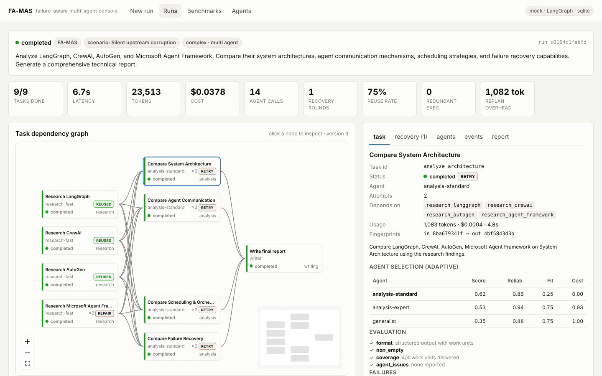
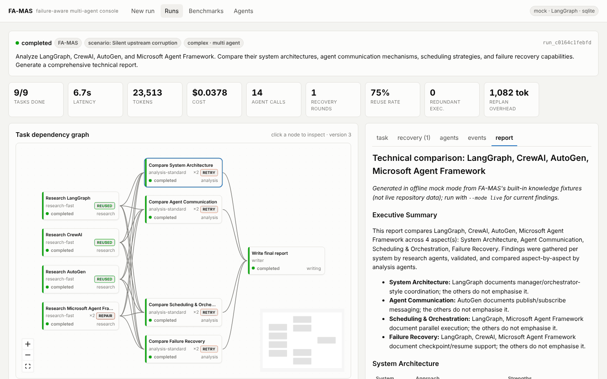
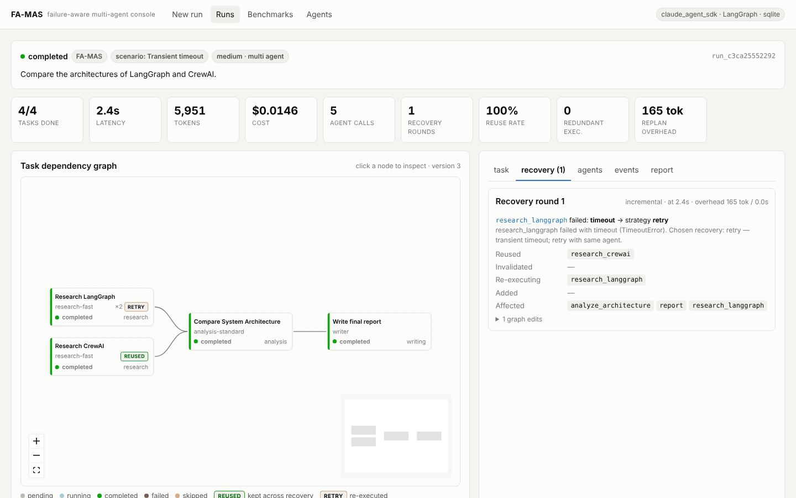
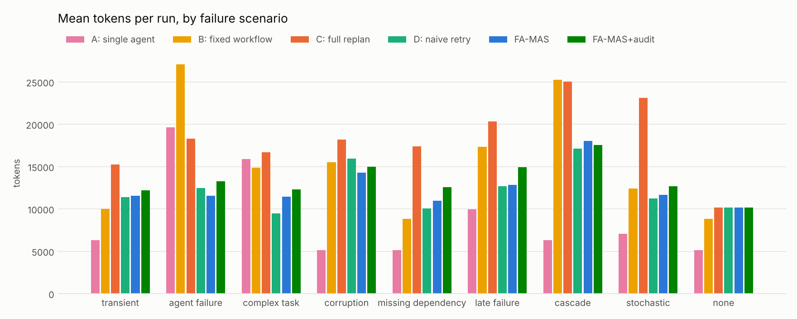

# FA-MAS: Failure-Aware Adaptive Multi-Agent System

> **v0.1.0-beta.1.** This is a research platform. **Mock mode is the default and the supported public execution
> mode**; it and the benchmark are verified. The Claude Agent SDK integration is **experimental**, intended only
> for personal, local testing by the account holder. Its three bounded real tests (A–C) passed on 2026-10-13 on
> the maintainer's own Claude Pro login. See [Project status](#project-status).

FA-MAS turns a complex natural-language request into a task DAG and assigns each subtask to the most
suitable agent. It runs independent work in parallel and validates every intermediate result. When something
fails, it **replans only the affected part of the graph** and reuses every result that is still provably
valid.

```
                 Task A (REUSED)
                    │
             ┌──────┴──────┐
             ▼             ▼
      Task B (RETRY)   Task C (REUSED)
             └──────┬──────┘
                    ▼
            Task D (RECOMPUTE)
                    ▼
             Task E (EXECUTE)
```

Every design choice can be swapped: planning, agent selection and recovery policy. A deterministic simulator
with controlled failure injection compares FA-MAS on identical tasks against four baselines: single agent,
fixed workflow, full replanning and naive retry.



## Contents

[Key features](#key-features) · [Architecture](#architecture) · [DAG scheduling](#dag-scheduling) ·
[Incremental replanning](#incremental-replanning) · [Screenshots](#screenshots) ·
[Installation](#installation) · [Mock mode](#mock-mode-no-model-no-key) ·
[Experimental: Claude Agent SDK](#experimental-claude-agent-sdk-personal-local-testing) · [Security](#security-considerations) ·
[Benchmark methodology](#benchmark-methodology) · [Test results](#test-results) ·
[Project status](#project-status) · [Known limitations](#known-limitations) · [Author](#author) ·
[License](#license)

## Key features

| | |
|---|---|
| Orchestration | LangGraph `StateGraph`: analyse → plan → validate → assign → execute → diagnose → assess impact → replan → finalize |
| Task graph | NetworkX DAG with Merkle-style content fingerprints for reuse, invalidation and early cut-off |
| Agents | research (fast / deep), analysis (standard / expert), coding (sandboxed), writing, generalist, aggregator |
| Agent selection | adaptive scoring: capability fit, learned reliability, cost tier, load; the rationale is stored per task |
| Recovery | failure classification with root-cause attribution and local impact analysis. Graph edits: retry, reassign, decompose with salvage, add dependency, add prerequisite, repair upstream, skip, abort |
| Models | deterministic mock (**default**), OpenAI-compatible or Anthropic API via LangChain (your own API key), or an **experimental** Claude Agent SDK provider for personal local testing |
| Backend | FastAPI with a Server-Sent Events stream; SQLite or PostgreSQL persistence; CLI (`famas`) |
| Frontend | React + React Flow: live DAG, task inspector, recovery timeline, agents, events, report, benchmarks |
| Experiments | 9 failure scenarios, 6 systems, 6 tasks; reproducible benchmark with CSV/JSON/Markdown and figures |

## Architecture

```
USER REQUEST → Task Analyzer → Planner → DAG Validator → Agent Selector → Dynamic Scheduler
                                   ▲                                         │  parallel agents
                                   │                                         ▼
                      Incremental Replanner ← Dependency Analyzer ← Failure Analyzer ← Result Evaluator
                                                                                         │ valid
                                                                                Result cache → Writer → report
```

| Layer | Modules |
|---|---|
| Planning | `planning/analyzer.py`, `planning/planner.py`, `planning/templates.py`, `planning/dag.py`, `planning/validator.py` |
| Orchestration | `orchestration/workflow.py` (LangGraph), `orchestration/dispatcher.py`, `orchestration/selector.py`, `orchestration/engine.py` |
| Execution | `agents/`, `tools/github.py` (read-only GitHub API), `tools/sandbox.py` |
| Models | `llm/mock.py`, `llm/langchain_client.py`, `llm/claude_agent_sdk_client.py` (+ `llm/claude_sdk_scripted.py` for offline dry runs) |
| Reliability and recovery | `recovery/evaluator.py`, `recovery/failure_analyzer.py`, `recovery/dependency_analyzer.py`, `recovery/replanner.py`, `recovery/policies.py` |
| State and monitoring | `core/events.py`, `monitoring/metrics.py`, `persistence/store.py`, `api/` |
| Experiments | `simulation/` (failure injection, scenarios, ground truth), `benchmark/` |

Details: [architecture](docs/architecture.md) · [algorithms](docs/algorithms.md) ·
[evaluation methodology](docs/evaluation.md) · [API](docs/api.md) · [development guide](docs/development.md) ·
[research report](docs/research_report.md) · [Claude Agent SDK provider](docs/claude-agent-sdk.md).

## DAG scheduling

The dispatcher is an eager, LLMCompiler-style scheduler over the task DAG:

* A task starts as soon as all of its dependencies are completed and validated, not at the next "round".
* Independent tasks run concurrently, bounded by `max_concurrency`.
* Before a task runs, its input fingerprint is compared with earlier results and the result cache. A match
  is reused without executing the task.
* Two clocks are available. A real clock is used for live models and paced demos. A discrete-event virtual
  clock is used for mock runs, so benchmark latencies are deterministic and still reflect parallelism and
  recovery stalls.

## Incremental replanning

Fixed multi-agent pipelines handle failures badly. One bad intermediate result often restarts large parts of
the workflow, re-spending tokens and time on work that was fine. Naive retries are cheap but blind: retrying a
task whose *input* is wrong just reproduces the failure. FA-MAS treats recovery as a dependency problem:

1. **Classify** the failure and **attribute a root cause**, which may be an upstream task. The failure types
   are: transient, agent capability, malformed or incomplete output, missing information, context
   inconsistency and dependency error.
2. **Compute the impact.** The repair set and its descendants are affected; every other completed result is
   reused.
3. **Patch the DAG** with one of these edits:
   * retry;
   * reassign to another agent;
   * split an oversized task, salvaging partial output;
   * add a forgotten dependency;
   * insert a missing prerequisite;
   * re-execute the upstream root cause with feedback.
4. **Re-validate by fingerprint** at dispatch time. If a re-executed upstream task produces identical
   output, downstream results are reused anyway (early cut-off).

Conditions that no recovery can fix abort the run instead of looping: a usage limit, refused credentials or
an exhausted model-call budget.

## Screenshots

The screenshots below were taken from the built UI with the backend running locally. All runs used mock mode
or a Claude dry run (scripted responses). None used a real model.

| New run | Task inspector and agent selection |
|---|---|
|  |  |
| **Final report** | **Experimental Claude provider, offline dry run, with a recovery round** |
|  |  |

The benchmark page, after a small benchmark run from the API, is shown in
[docs/images/ui-benchmarks.png](docs/images/ui-benchmarks.png).

## Installation

Requires Python 3.11+. The UI also needs Node 18+.

```bash
git clone https://github.com/LZH-1-G/FA-MAS.git fa-mas && cd fa-mas
python -m venv .venv && source .venv/bin/activate
pip install -e ".[dev]"            # core + tests; add extras as needed:
#   ".[bench]"      pandas + matplotlib for benchmark figures
#   ".[openai]"     OpenAI-compatible APIs (API key)       ".[anthropic]"  Anthropic API (API key)
#   ".[claude]"     experimental Claude Agent SDK provider (personal local testing only)
#   ".[postgres]"   PostgreSQL persistence                  ".[all]"        everything
pytest                             # fully offline, no model calls
scripts/verify-offline.sh          # all offline release checks: lint, tests, benchmark reproducibility,
                                   # Claude dry runs, UI build, npm audit (needs ".[dev,claude]" + Node)
```

Web console:

```bash
cd frontend && npm ci && npm run build && cd ..
famas serve                        # API + built UI on http://127.0.0.1:8000
# development: famas serve --reload  and  cd frontend && npm run dev  (http://localhost:5173)
```

With Docker, `docker compose up --build` starts FastAPI, the UI and PostgreSQL on `127.0.0.1:8000`. This path
was not re-verified for this release.

## Mock mode (no model, no key)

Mock mode is the default. A deterministic mock model with modelled token counts, latency and cost lets the
whole pipeline run offline: planning, agents, evaluation, failure injection and replanning.

```bash
# watch FA-MAS trace a silently corrupted research result to its source and repair only what depends on it
famas run "Analyze LangGraph, CrewAI, AutoGen, and Microsoft Agent Framework. Compare their system \
architectures, agent communication mechanisms, scheduling strategies, and failure recovery capabilities." \
  --scenario corruption --out report.md

famas scenarios / famas systems    # what can be injected / compared
famas bench --plots                # full baseline comparison -> benchmarks/results/
```

Mock reports are built from FA-MAS's hand-written offline fixtures and say so in their first line. They are
not current facts about the compared projects.

## Experimental: Claude Agent SDK (personal local testing)

> **Experimental, not a public execution mode.** Mock mode stays the default. This provider exists so the
> account holder can test FA-MAS on their **own machine** with their **own** Claude Code login. FA-MAS does
> not offer, provide, host or broker Claude sign-in for anyone. Anthropic requires products and services
> built on the Agent SDK to use API-key authentication. It does not permit third-party apps to offer
> claude.ai login or to route requests through Free, Pro or Max credentials on behalf of their users
> ([legal and compliance](https://code.claude.com/docs/en/legal-and-compliance),
> [Agent SDK overview](https://code.claude.com/docs/en/agent-sdk/overview)). If you are building something for
> other people, use an API-key provider instead.

With `FAMAS_LLM_PROVIDER=claude_agent_sdk`, FA-MAS's agents call Claude through the official
[Claude Agent SDK](https://code.claude.com/docs/en/agent-sdk/overview), which runs the unmodified Claude Code
CLI. Claude Code is signed in to your own account through Anthropic's own `/login`. FA-MAS never reads,
stores or forwards credentials. Calls draw on your plan's shared usage limits.

```bash
pip install -e ".[claude]"
claude                                       # once: /login with your own Claude account, then /exit
famas claude doctor --offline-test --check-login   # no model call; confirms the login is your subscription
FAMAS_LLM_PROVIDER=claude_agent_sdk FAMAS_CLAUDE_DRY_RUN=true famas claude validate b   # free offline rehearsal
```

Safety defaults:

* **Real calls are off.** They need `FAMAS_CLAUDE_ALLOW_REAL_CALLS=true`, and the validation tests also need
  `--yes`.
* **Local only.** The API server refuses to listen on anything but `127.0.0.1` while this provider can make
  real calls. There is no override, so the provider cannot be offered to other users over the network.
* **No API-key billing.** The provider refuses to run if Claude Code would bill an API key, a gateway, a
  Console profile or a cloud account. It checks the credential source in Claude Code's handshake **before
  any prompt is sent**.
* **Stops at limits.** It stops at a usage limit or at any sign of usage credits (extra usage).
* **Bounded.** Calls per run, parallel sessions, turns, time and estimated cost per call are all capped.
* **No tools.** Claude Code runs without tools: no shell, file or web access.

Three bounded real tests are documented in [docs/real-claude-validation.md](docs/real-claude-validation.md),
with exact commands, expected consumption and the measured results. Test A (2 calls) comes first; Tests B and
C each need separate approval. The maintainer ran all three on 2026-10-13. Policy, billing and design details
are in [docs/claude-agent-sdk.md](docs/claude-agent-sdk.md).

## Security considerations

* **Local by design.** The API has no user accounts. `famas serve` binds to `127.0.0.1`. It refuses a public
  interface while a live provider is configured, and with the experimental Claude Agent SDK provider there is no
  override. CORS allows only the local UI, and Host-header checks block DNS rebinding.
* **Credentials.** None are stored by FA-MAS. `.env` is gitignored, and only `.env.example` (placeholders) is
  tracked. Claude Code keeps its own login, in the macOS Keychain on Macs.
* **Model-written code.** Execution is **off** in live mode unless you set `FAMAS_ALLOW_GENERATED_CODE=true`.
  The sandbox (isolated interpreter, empty temp dir, CPU, memory and file limits, scrubbed environment) does
  not isolate the network or your files.
* **Untrusted content.** Fetched README text is fenced as untrusted data in prompts. Claude runs with no tools.
  Prompt injection can still distort a report's *content*; treat live reports as drafts.
* **Logs.** Usage logs and validation reports hold metadata only (tokens, models, timings). The local run
  database (`data/`, gitignored) holds your requests and generated reports.

The audit behind these measures is in [docs/security-audit.md](docs/security-audit.md). Report
vulnerabilities as described in [SECURITY.md](SECURITY.md).

## Benchmark methodology

* **Size.** 468 runs: 6 tasks × 9 failure scenarios × 6 systems, with the stochastic scenario repeated over 5
  seeds.
* **Determinism.** The runs use the deterministic simulator: a mock model with modelled tokens, latency and
  cost, a virtual clock, and seeded failure injection with a ground-truth oracle that marks corrupted
  results.
* **Correctness.** A run is correct only if it completes and its final output contains no corrupted
  information.
* **Robustness check.** Imperfect error detection is evaluated separately, at p = 0.5 and p = 0.8.

Means over the 8 scenarios that inject failures:

| System | Correct output | Latency | Tokens | Cost* | Redundant executions | Reuse rate |
|---|---:|---:|---:|---:|---:|---:|
| A: single agent | 71% | 73.6 s | 8,641 | $0.0434 | 0.00 | – |
| B: fixed workflow | 88% | 69.1 s | 15,069 | $0.0171 | 0.86 | 0% |
| C: dynamic + full replanning | 93% | 89.0 s | 20,574 | $0.0500 | 4.97 | 0% |
| D: dynamic + naive retry (ablation) | 71% | 56.1 s | 12,121 | $0.0331 | 0.00 | 100% |
| **FA-MAS** | **97%** | **60.5 s** | **12,418** | **$0.0315** | **0.00** | **96%** |
| FA-MAS + reuse audit | 97% | 60.8 s | 13,424 | $0.0314 | 0.00 | 96% |

\*Modelled cost of the mock model, not a real bill.

Against full replanning (C), FA-MAS used about 40% fewer tokens and 32% less time, with equal or better
correctness. Against naive retry (D), it was correct far more often at a similar cost, because D cannot
repair upstream causes, decompose tasks or add missing dependencies.

With imperfect detection, incremental reuse can keep a corrupted result that nobody has flagged yet. The
optional reuse audit narrows that gap ([research report](docs/research_report.md)).

**These are simulation results.** They show that the mechanisms work and what they cost. They are not
measurements of real-model behaviour.

**Reproducibility.** `famas bench` reproduces all three committed result sets bit-for-bit. This was checked
with the LangGraph runtime and with the built-in fallback runtime, on Linux (x86-64 and arm64) and natively on
macOS. Cost totals are summed order-independently. Six stored costs differ from the first commit by
$0.000001: they are exact half-micro-dollar ties, and no outcome or summary changed
([cost arithmetic](docs/evaluation.md#cost-arithmetic-and-reproducibility)). Full method:
[docs/evaluation.md](docs/evaluation.md).



## Test results

These results are for the v0.1.0-beta release candidate, on 2026-10-13. Every check in the first table ran
offline with no model calls.

| Check | Environment | Result |
|---|---|---|
| `pytest` (177 tests) | Python 3.11, LangGraph 1.2.14, claude-agent-sdk 0.2.165: the same package versions as the maintainer's Mac `.venv` | 177 passed |
| `pytest` | Python 3.13, LangGraph 1.2.14, claude-agent-sdk 0.2.159 | 177 passed |
| `pytest` | Python 3.13, built-in fallback runtime (no LangGraph) | 176 passed, 1 skipped (needs `langchain-core`) |
| `pytest` without `claude-agent-sdk` installed | Python 3.13, fallback runtime | 164 passed, 13 skipped (SDK-transport tests) |
| `ruff check` / `ruff format --check` | | clean |
| `npm run build` (TypeScript + Vite 6.4.4) | Node 22 | success |
| Browser end-to-end check (Playwright, built UI + API) | mock run, benchmark page, Claude dry run, Vite dev server with `/api` proxy | no console errors or failed requests |
| Benchmark reproducibility | 468 + 400 + 400 runs | identical to committed results (cost arithmetic: [docs/evaluation.md](docs/evaluation.md#cost-arithmetic-and-reproducibility)) |
| Package build (`uv build`) and clean install | wheel + sdist, Apache-2.0 metadata | installs; mock run with recovery completes |
| `pip-audit` (90 Python packages) / `npm audit` (all npm dependencies, including dev) | | 0 known vulnerabilities |
| `scripts/verify-offline.sh`, native macOS (maintainer's Mac, Python 3.11.17) | all offline checks | all passed except one test that compared `/var` and `/private/var` path strings. The test was fixed to compare canonical paths; native re-run pending. |

**Real Claude validation** (maintainer's Mac, 2026-10-13, Claude Pro via the claude.ai login, claude-agent-sdk
0.2.165; details in [docs/real-claude-validation.md](docs/real-claude-validation.md#results-2026-10-13)):

| Test | Result | Prompts sent (cap) | Run metrics | API-equivalent estimate* |
|---|---|---|---|---|
| A: smoke | completed: plain reply and structured (JSON-schema) reply both correct | 2 (2) | – | $0.000656 |
| B: real workflow (LangGraph vs CrewAI) | completed: 11/11 tasks, report of 11,783 characters, no recovery needed | 11 (12) | `llm_calls` 11, `agent_invocations` 11 | $0.123258 |
| C: failure recovery (`transient`) | completed: 10/10 tasks. The injected timeout was diagnosed, only `research_langgraph` was retried and `research_crewai` was reused. | 12 (16) | `llm_calls` 13 = 12 real + 1 simulated (the injected timeout sends no prompt), `agent_invocations` 11 | $0.122186 |

\*Claude Code's client-side estimate at API list prices, not a charge: the calls used the Pro plan's limits. No
rate-limit rejection or overage was reported.

## Project status

| Area | Status |
|---|---|
| **Verified mock functionality** | Planning, eager DAG scheduling, adaptive agent selection, evaluation, failure injection (9 scenarios), incremental replanning and all baselines; API, SSE and UI; benchmark and its reproducibility |
| **Implemented SDK integration (experimental)** | The `claude_agent_sdk` provider is tested offline with fake sessions and with the real SDK client over a scripted transport. It includes the safety gates, usage/rate-limit handling, bounded validation tests A–C and the dry-run mode. |
| **Verified real Claude functionality** | Bounded tests A–C on 2026-10-13, on the maintainer's Mac with their Claude Pro login (25 prompts in total, all within their caps): plain and native structured replies (A); a full multi-agent research workflow (B); and failure diagnosis with incremental recovery: one task retried, one valid result reused (C). See the table above. |
| **Unverified features** | real-model runs of the API-key providers (OpenAI-compatible, Anthropic API); real Claude runs beyond the three bounded tests (other requests, larger plans, sustained use); live GitHub research at scale; Docker / docker-compose; PostgreSQL persistence; Windows |

## Known limitations

* **Simulator.** The failure model was designed together with the system. It shows *that* the mechanisms
  work and what they cost, not how often real agents fail in these ways.
* **Undetected corruption.** Incremental reuse keeps results nobody has flagged. If a corruption is never
  detected, FA-MAS delivers it, as does every system that does not re-execute everything. The reuse audit
  only helps during recovery rounds.
* **Single-agent requests.** When FA-MAS judges a request simple enough for one agent, it inherits that
  agent's lack of cross-checking. It does escalate to a multi-agent plan when that agent fails.
* **Sandbox.** The code sandbox contains accidents, not adversaries. Model-written code is off by default in
  live mode.
* **Claude provider.** Each call starts a Claude Code process, adding about 1–3 s per call. Overage detection
  reacts to Claude Code's rate-limit events, so keeping usage credits off in your account is the only hard
  guarantee. Anthropic does not publish exact Pro quotas.
* **No authentication.** The API is single-user and local. Do not expose it on a network.

## Author

**Author:** lzh

## License

Copyright 2026 lzh. Licensed under the [Apache License 2.0](LICENSE). See [NOTICE](NOTICE) and
[THIRD_PARTY_NOTICES.md](THIRD_PARTY_NOTICES.md) for third-party licenses and trademarks. This project is not
affiliated with or endorsed by Anthropic, LangChain, CrewAI, Microsoft or any other project it mentions.
