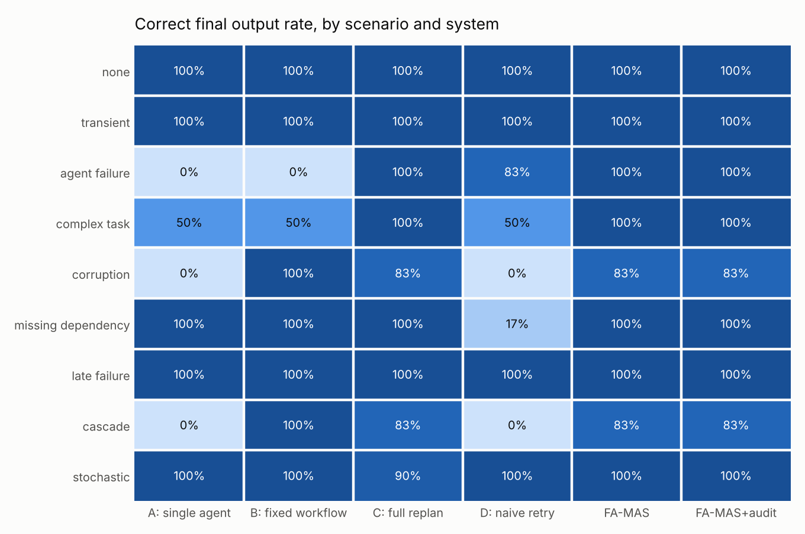
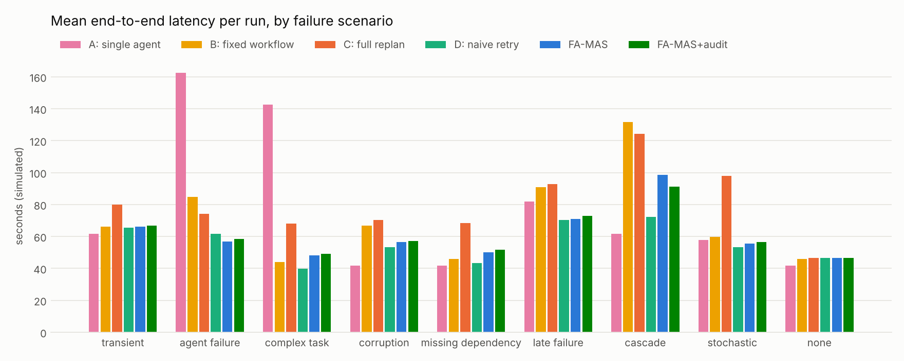

# Failure-Aware Incremental Replanning for Dynamic Multi-Agent Task Execution

*FA-MAS technical report — v0.1 (October 2026)*

## Abstract

LLM-based multi-agent systems increasingly plan their own workflows, but they still recover from intermediate
failures crudely: they retry the failed step blindly, or they re-plan and re-execute large parts of the
workflow. We present FA-MAS, a multi-agent system that executes a dynamically generated task DAG and treats
recovery as a dependency problem. On failure it classifies the failure, attributes a root cause (possibly an
upstream task whose output a downstream agent found contradictory), computes the affected region of the DAG,
and patches only that region — retrying, reassigning, decomposing oversized tasks while salvaging partial
output, adding forgotten dependencies, or repairing the upstream root cause. Reuse is made sound by Merkle-style
content fingerprints over task specifications and inputs, which also give early cut-off when a re-executed task
reproduces its earlier output. In a deterministic simulation with controlled failure injection (468 runs, six
tasks, nine scenarios), FA-MAS produced a correct final output in 97 % of failure-injected runs, against 93 % for
dynamic planning with full replanning, 88 % for a fixed pipeline, and 71 % for both a single agent and naive
local retry. Compared with full replanning it used about 40 % fewer tokens and 32 % less end-to-end time and
performed no redundant executions. The experiments also expose the method's main weakness: incremental reuse
preserves errors that have not yet been detected. When detection is imperfect (p = 0.5), full replanning
recovers more often (90 % vs 80 %) because it recomputes everything; an optional *reuse audit* that re-verifies
preserved upstream results narrows the gap (85 %) at roughly 30 % lower cost than full replanning. All results
come from a simulator designed alongside the system; they characterise mechanisms and trade-offs, not real-world
effect sizes.

## 1. Introduction

A multi-agent system that decomposes a request such as *"Analyse LangGraph, CrewAI, AutoGen and Microsoft Agent
Framework, compare their architectures, communication, scheduling and failure recovery, and write a report"*
produces a graph of a dozen dependent LLM calls. Some will fail: a tool times out, a model returns malformed
JSON, a task is too large for one pass, the planner forgets a dependency, or an agent produces a plausible but
wrong claim that is only noticed when a downstream agent tries to reconcile it with other evidence.

What should happen next? Two common answers are both unsatisfying:

* **Restart or re-plan broadly.** Correct-by-construction for transient faults, but it re-spends tokens and time
  on everything that already worked, and late failures (e.g. in the final writing step) are the most expensive.
* **Retry the failed step.** Cheap, but blind: if the failed step's *input* is the problem, the retry reproduces
  the failure, or — worse — retries until a noisy check happens to pass and the error ships.

We argue recovery should be **failure-aware** (use the evidence about *why* something failed, including blame on
upstream tasks) and **dependency-aware** (change only what the failure affects and reuse everything else). Our
contributions, stated as research objectives rather than established findings:

1. **Failure-aware dependency analysis** — a classification of task failures with root-cause attribution from
   structured evaluator and agent issues, and an impact analysis that partitions completed results into
   *reusable* and *invalidated* (§4.3–4.4).
2. **Incremental replanning** — a set of local DAG edits (retry, reassign, decompose with salvage, escalate a
   single-agent task to a multi-agent plan, add dependency, add prerequisite, repair upstream) whose soundness
   is enforced by content fingerprints with early cut-off (§4.2, §4.5).
3. **An integrated, measurable system** — eager DAG scheduling, adaptive agent selection, and the recovery
   machinery in one LangGraph-orchestrated implementation with a controlled-failure benchmark harness and
   baselines that isolate recovery *scope* and failure *awareness* (§5–6).

## 2. Related work

**Planning and parallel execution.** LLMCompiler (Kim et al., ICML 2024) has a planner emit a DAG of function
calls with placeholder variables, a task-fetching unit that dispatches tasks as soon as their dependencies
resolve, and a re-planning loop that sends intermediate results back to the planner. FA-MAS adopts the eager
dispatch idea for agent tasks. Its recovery differs in scope: instead of asking the planner for a new plan from
the current state, it edits the existing DAG locally and reuses validated results.

**Automated multi-agent design.** AFlow (Zhang et al., ICLR 2025) searches over code-represented workflows with
Monte Carlo tree search; MaAS (Zhang et al., ICML 2025) samples query-dependent multi-agent architectures from an
"agentic supernet"; DyLAN (Liu et al., COLM 2024) builds a dynamic agent network with inference-time agent
selection and an agent-importance score for team optimisation; BAMAS (Yang et al., AAAI 2026) chooses LLMs under a
budget with integer linear programming and a collaboration topology with reinforcement learning; AgentPrune (Zhang
et al., ICLR 2025) prunes redundant communication in multi-agent message-passing graphs. These works optimise the
*structure* or *cost* of a system before or during execution; they are largely orthogonal to how a running
system recovers from a failed intermediate step, and FA-MAS's adaptive agent selection is a much simpler,
heuristic relative of their selection components.

**Failures in multi-agent systems.** The MAST taxonomy (Cemri et al., 2025) categorises why multi-agent LLM
systems fail (specification issues, inter-agent misalignment, task verification). Zhang et al. (ICML 2025)
study automated failure attribution — which agent and which step caused a failure — from execution logs.
FA-MAS performs a lightweight, structured form of attribution at run time: agents and evaluators emit typed
issues (e.g. *inconsistency, source = research_autogen*) and the failure analyzer accepts blame only on true DAG
ancestors. Magentic-One (Fourney et al., 2024) keeps task and progress ledgers and re-plans in an outer loop when
progress stalls; that is global re-planning, closer to our baseline C.

**Incremental computation.** Build systems recompute only what changed and stop early when a rebuilt artefact
is unchanged (Mitchell, ICFP 2012; Mokhov, Mitchell & Peyton Jones, ICFP 2018). Spark recovers lost partitions by
recomputing them from lineage (Zaharia et al., NSDI 2012). Framework-level checkpointing in LangGraph keeps the
writes of nodes that succeeded in a failed step. FA-MAS transfers the fingerprint and early cut-off ideas to
agent workflows, where "inputs" include natural-language feedback and where a *downstream* consumer can
invalidate an *upstream* output after the fact — a direction build systems do not need.

## 3. Problem formulation

A request is planned into a DAG `G = (V, E)`. Each task `v` has a specification, a set of work units it must
deliver, an assigned agent and, once executed, a result. A **failure** is either an execution error or a result
rejected by validation; a failure of `v` may be caused by `v`'s agent, `v`'s specification, the plan structure,
or an incorrect upstream result. A **recovery policy** maps failures to a modified DAG and a set of tasks to
(re-)execute. We want policies that maximise the probability of a *correct* final output while minimising tokens,
cost, latency and redundant work, subject to per-task and per-run retry budgets.

## 4. Method

### 4.1 Execution model

The planner emits a DAG whose tasks declare work units (`research:crewai:scheduling`, `report:summary`, …). An
eager scheduler launches every task whose dependencies are completed and validated, up to a concurrency bound.
Every output is validated (structure, unit coverage, agent-reported blocking issues; optionally an LLM judge)
before it is released downstream. On the first failure the scheduler stops launching new work, lets in-flight
tasks finish, and hands all failures of the wave to recovery.

### 4.2 Fingerprints

`out_fp(r) = H(content, public data)` and `in_fp(v) = H(H(spec(v)), {u ↦ out_fp(r(u))})`. A stored result is
reused iff its recorded input fingerprint equals the task's current one. Recovery feedback is part of the spec,
so adding feedback forces re-execution; an upstream output change invalidates downstream results transitively;
and an unchanged upstream output after re-execution lets invalidated downstream results be reused (early
cut-off).

### 4.3 Failure analysis

Failures are classified into timeout, tool error, resource limit, agent error, invalid output, incomplete output,
missing information, context inconsistency and dependency error (Appendix A). Root causes come from structured
issues: an analysis agent that finds contradictory evidence names the upstream task; an agent missing
information names the subject or aspect, which the analyzer maps to the task that should provide it. A strategy
table (Appendix A) selects retry, reassignment, decomposition, dependency repair, prerequisite insertion or
upstream repair; budgets bound everything.

### 4.4 Impact analysis

With repair set `R` (failed tasks plus blamed root causes), the affected region is `A = R ∪ desc(R)`. Completed
results outside `A` are reused; completed results inside `A` are invalidated but kept as candidates for early
cut-off. Because the replanner only modifies tasks in `R` and adds nodes/edges whose heads are in `R` or new,
every reused result's input fingerprint is unchanged — reuse is sound with respect to the plan (but not with
respect to errors nobody has detected; §7.3).

### 4.5 Incremental replanning

* **Retry / reassign** a failed task (failing agents are excluded).
* **Decompose** an oversized task by binary splitting of its missing units; valid partial output is *salvaged* as
  its own completed node; the original node becomes a deterministic merge so downstream edges are untouched.
* **Escalate** a failing single-agent task into the multi-agent plan when no other agent can take it.
* **Add dependency / prerequisite** when information is missing and the provider exists / does not exist.
* **Repair upstream**: re-execute the blamed task with the downstream complaint as feedback and invalidate its
  completed descendants.
* **Reuse audit** (optional): re-verify preserved upstream results feeding the re-executed region, once each, with
  a small model.

### 4.6 Adaptive agent selection

Agents are scored on posterior reliability (Beta prior updated per agent and task type), tier/complexity fit,
specialisation, and cost and latency per *successful* completion (cost/reliability), minus current load.

## 5. Implementation

FA-MAS is a Python 3.11+ package (≈ 9k lines, plus ≈ 1k lines of tests) with a React/React Flow console. LangGraph orchestrates the phases
(analyse, plan, validate, assign, execute, diagnose, assess impact, replan, finalise); NetworkX holds the task DAG;
LangChain provides OpenAI-compatible and Anthropic chat models; FastAPI exposes runs, an SSE event stream and
benchmarks; SQLite or PostgreSQL persist runs, events, a content-addressed result cache and agent statistics.
Research agents use the GitHub API in live mode; the coding agent writes Python that runs in a sandboxed
subprocess. Every component calls models with a deterministic mock callback, so the identical code path runs
offline for tests and benchmarks. See `docs/architecture.md`.

## 6. Experimental setup

**Systems.** A: single agent (restart on failure). B: fixed research → analysis → (code) → report pipeline
(restart). C: dynamic planning + adaptive selection + *full replanning* (same diagnosis and graph fixes as FA-MAS,
plus a planner call, then everything recomputed). D: dynamic + *naive local retry* (ablation without root-cause
attribution, decomposition or dependency repair). FA-MAS, and FA-MAS + reuse audit. Same agents, models, budgets
(4 failed attempts per task, 8 recovery rounds per run) and failure injection for all.

**Tasks.** Six repository-research requests from 1 subject × 1 aspect up to 5 subjects × 5 aspects with a
computed feature matrix.

**Scenarios.** None; transient timeout; incapable agent; task too complex; silent upstream corruption; planner
omits a dependency; late failure in report writing; a cascade of three faults; stochastic faults (≈ 12 % per
execution, 5 seeds). Faults target work units so they apply equally to monolithic and fine-grained plans.

**Simulation.** A mock LLM models tokens (≈ 4 chars/token), latency (tier-dependent base + per-token costs) and
cost (nominal list prices); a discrete-event simulation of the scheduler yields deterministic latencies. A
downstream analysis agent detects a corrupted input with probability `p` (default 1). Details and limitations:
`docs/evaluation.md`. Reproduce with `famas bench --plots`.

## 7. Results

### 7.1 Main comparison

Means over the 432 runs of the eight failure-injecting scenarios (72 per system):

| System | Correct | Completed | Latency | Tokens | Cost | Agent calls | Redundant exec. | Wasted tokens | Recovery overhead |
|---|---:|---:|---:|---:|---:|---:|---:|---:|---:|
| A: single agent | 71 % | 88 % | 73.6 s | 8,641 | $0.0434 | 1.8 | 0.00 | 4,221 | 0 |
| B: fixed workflow | 88 % | 88 % | 69.1 s | 15,069 | $0.0171 | 5.1 | 0.86 | 7,159 | 0 |
| C: full replanning | 93 % | 96 % | 89.0 s | 20,574 | $0.0500 | 13.0 | 4.97 | 8,836 | 1,804 |
| D: naive retry | 71 % | 74 % | 56.1 s | 12,121 | $0.0331 | 8.5 | 0.00 | 3,358 | 0 |
| **FA-MAS** | **97 %** | **100 %** | **60.5 s** | **12,418** | **$0.0315** | **8.1** | **0.00** | **1,849** | **309** |
| FA-MAS + audit | 97 % | 100 % | 60.8 s | 13,424 | $0.0314 | 7.9 | 0.00 | 1,664 | 1,501 |

Relative to C, FA-MAS used 40 % fewer tokens, 37 % less cost and 32 % less time, with no redundant executions and
96 % of completed results preserved across recovery rounds. D is as cheap but fails whenever the cause is not the
failed task itself. A and B are cheap per run (B uses small models throughout) but cannot adapt structure: they
fail every run where the chosen agent is incapable and every run with a task too large for one pass.

### 7.2 Per-scenario behaviour

Selected means (6 runs per cell for deterministic scenarios, 30 for stochastic):

| Scenario | C: full replanning | D: naive retry | FA-MAS | Mechanism exercised |
|---|---|---|---|---|
| transient | 15.2k tok · 80.1 s | 11.4k · 65.5 s | 11.5k · 66.1 s | retry; siblings reused |
| agent failure | 100 % · 18.3k · 74.2 s | 83 % | 100 % · 11.6k · 57.0 s | reassignment; escalation of single-agent task |
| task too complex | 100 % · 16.7k · 68.0 s | 50 % | 100 % · 11.5k · 48.3 s | decomposition with salvage |
| silent corruption | 83 % · 18.2k | 0 % | 83 % · 14.3k | root-cause attribution, upstream repair |
| missing dependency | 100 % · 17.4k · 68.4 s | 17 % | 100 % · 10.9k · 50.3 s | edge insertion |
| late failure | 20.3k · 92.7 s | 12.7k · 70.4 s | 12.8k · 71.0 s | everything upstream reused |
| cascade | 83 % · 25.0k · 124 s | 0 % | 83 % · 18.0k · 98.7 s | combination |
| stochastic | 90 % · 23.1k · 98.1 s | 100 % · 11.3k | 100 % · 11.7k · 55.6 s | recomputation multiplies exposure |

Two observations stand out. First, the cost of full replanning grows with *how late* the failure occurs: a
malformed final report costs C a complete recomputation (20.3k vs 12.8k tokens). Second, under random faults
full replanning is not just expensive but less reliable: every recomputation is another chance to fail, and in
3 of 30 stochastic runs C exhausted its recovery budget. The 17 % gap for both C and FA-MAS under silent
corruption is the simple task T1, for which both planners choose a single agent that has no downstream consumer
to notice the error (§7.4).

### 7.3 When reuse is wrong: imperfect detection

Incremental reuse is only as good as error detection. We reran the corruption and cascade scenarios on T2–T6
with 10 seeds and detection probability `p` ∈ {0.5, 0.8} (100 runs per system and `p`):

| p | System | Correct | Tokens | Cost | Latency | Invalid reuse rate |
|---|---|---:|---:|---:|---:|---:|
| 0.5 | C: full replanning | 90 % | 24,585 | $0.0597 | 110.0 s | – |
| 0.5 | D: naive retry | 0 % | 16,085 | $0.0442 | 83.8 s | 55 % |
| 0.5 | FA-MAS | 80 % | 18,034 | $0.0434 | 86.6 s | 13 % |
| 0.5 | FA-MAS + audit | 85 % | 19,155 | $0.0427 | 85.9 s | 7 % |
| 0.8 | C: full replanning | 95 % | 25,034 | $0.0605 | 111.6 s | – |
| 0.8 | D: naive retry | 0 % | 17,309 | $0.0480 | 73.3 s | 46 % |
| 0.8 | FA-MAS | 90 % | 18,473 | $0.0437 | 88.0 s | 10 % |
| 0.8 | FA-MAS + audit | 94 % | 19,161 | $0.0424 | 85.6 s | 3 % |

The gap comes entirely from the cascade scenario (corruption alone: 80 % for all three at p = 0.5, 90 % at
p = 0.8 — when nobody notices the corruption, nobody recovers). In the cascade, an *unrelated* failure (a
timeout or the late report failure) makes C recompute everything, which happens to replace the still-undetected
corrupted result with a clean one; FA-MAS deliberately keeps it. The reuse audit recovers most of that
difference (cascade: 80 → 90 % at p = 0.5, 90 → 98 % at p = 0.8) while remaining ~30 % cheaper than C, because
verification runs on a small model and only on results that feed the region about to be re-executed.

Naive retry is worst in this setting for an instructive reason: re-running the downstream task re-rolls the
noisy check until it passes, and the corrupted upstream result is then accepted (0 % correct).

### 7.4 Adaptivity has a price

For the simple request (T1) FA-MAS chooses a single agent. Without failures this costs 2.2k tokens — a little
more than the bare single-agent baseline (1.9k; the difference is task analysis and planning) and less than the
three-stage fixed pipeline (2.7k). When that agent proves incapable, FA-MAS
escalates to the multi-agent plan and succeeds. But a silent error in a single-agent result has no downstream
consumer to expose it, so FA-MAS (and C, which uses the same planner) inherits the single agent's blind spot.
A verification pass for single-agent outputs — or a policy that only collapses to a single agent when an
independent check is available — would close it.

### 7.5 Overhead

FA-MAS's recovery overhead (failure explanation calls, local replanning calls) averaged 309 tokens per
failure-injected run, versus 1,804 for C's re-planning calls. The audit raises FA-MAS's overhead to about
1,500 tokens but, using a small model, leaves cost flat ($0.0314 vs $0.0315).

## 8. Discussion

**Recovery scope is the main lever.** C and FA-MAS share diagnosis and graph fixes; their difference is what they
recompute. C pays for that breadth on every failure — and gains robustness against errors nobody has detected.
That suggests treating scope as a tunable: incremental by default, with targeted verification or periodic broad
recomputation when detection is known to be weak.

**Failure awareness is the second lever.** D shares FA-MAS's scope but not its analysis. It matches FA-MAS when
the failed task is the culprit (transient faults, late failures, many stochastic faults) and collapses when the
cause lies elsewhere: upstream corruption, a missing dependency, a task that must be split.

**Detection quality bounds everything.** Every system was evaluated with the same detector. Improving detection
(stronger cross-checks, LLM judges, consistency checks between independent sources) benefits incremental
recovery most, because incremental recovery relies on detection to decide what to recompute.

## 9. Limitations

* The simulator, scenarios and detection model were designed together with FA-MAS. The results demonstrate that
  the mechanisms work and quantify their cost structure under those assumptions; they are not estimates of
  real-world performance. Real failures are partial, correlated and harder to attribute.
* Quality is modelled as binary correctness; model tiers differ in cost, latency and failure rate but not in
  output quality.
* Cells for deterministic scenarios have six runs (one per task); differences of one run move a cell by ~17 points.
* Mock planning uses templates; with live LLM planners, plans vary between runs, which affects reuse.
* The failure analyzer is rule-based (an LLM writes explanations); learned classifiers or LLM-based attribution
  were not evaluated.
* No live-model experiments are reported here. The harness supports them (`mode="live"` with failure injection).

## 10. Future work

1. Live-model study on a broader task set with graded quality (human or LLM-judge) and real failure logs.
2. Confidence-weighted reuse: keep a suspicion score per result (from agent self-reports, disagreement between
   sources, lineage of past repairs) and decide per result between reuse, audit and recomputation.
3. Semantic early cut-off: treat a re-executed output as unchanged when it is *equivalent*, not identical.
4. Learned recovery policies (bandits over strategies per failure type) and learned failure attribution.
5. Asynchronous recovery that overlaps diagnosis with still-running sibling tasks instead of draining them.
6. Cost-aware scheduling that weighs a task's failure probability and the size of its downstream cone.

## 11. Conclusion

Treating recovery as a dependency problem — classify, attribute, compute the affected region, patch locally,
reuse what is provably unaffected — let FA-MAS recover from every injected failure type in our simulator at
roughly the cost of naive retries and far below the cost of re-planning, with no redundant work. The same
experiments show where the approach must be careful: reuse is sound with respect to the plan but not with
respect to undetected errors, so detection quality and targeted verification matter as much as the replanning
algorithm itself.

## References

* M. Cemri, M. Z. Pan, S. Yang, et al. *Why Do Multi-Agent LLM Systems Fail?* arXiv:2503.13657, 2025 (NeurIPS 2025 Datasets & Benchmarks).
* A. Fourney, G. Bansal, H. Mozannar, et al. *Magentic-One: A Generalist Multi-Agent System for Solving Complex Tasks.* arXiv:2411.04468, 2024.
* S. Kim, S. Moon, R. Tabrizi, N. Lee, M. W. Mahoney, K. Keutzer, A. Gholami. *An LLM Compiler for Parallel Function Calling.* ICML 2024 (arXiv:2312.04511).
* Z. Liu, Y. Zhang, P. Li, Y. Liu, D. Yang. *A Dynamic LLM-Powered Agent Network for Task-Oriented Agent Collaboration* (DyLAN). COLM 2024 (arXiv:2310.02170).
* N. Mitchell. *Shake Before Building: Replacing Make with Haskell.* ICFP 2012.
* A. Mokhov, N. Mitchell, S. Peyton Jones. *Build Systems à la Carte.* ICFP 2018.
* L. Yang, J. Luo, X. Liu, Y. Lou, Z. Chen. *BAMAS: Structuring Budget-Aware Multi-Agent Systems.* AAAI 2026 (arXiv:2511.21572).
* M. Zaharia, M. Chowdhury, T. Das, et al. *Resilient Distributed Datasets: A Fault-Tolerant Abstraction for In-Memory Cluster Computing.* NSDI 2012.
* G. Zhang, L. Niu, J. Fang, K. Wang, L. Bai, X. Wang. *Multi-agent Architecture Search via Agentic Supernet* (MaAS). ICML 2025 (arXiv:2502.04180).
* G. Zhang, Y. Yue, Z. Li, et al. *Cut the Crap: An Economical Communication Pipeline for LLM-based Multi-Agent Systems* (AgentPrune). ICLR 2025 (arXiv:2410.02506).
* J. Zhang, J. Xiang, Z. Yu, et al. *AFlow: Automating Agentic Workflow Generation.* ICLR 2025.
* S. Zhang, M. Yin, J. Zhang, et al. *Which Agent Causes Task Failures and When? On Automated Failure Attribution of LLM Multi-Agent Systems.* ICML 2025 (arXiv:2505.00212).

## Appendix A — Failure types and strategies

| Failure type | Typical cause | FA-MAS strategy |
|---|---|---|
| timeout / tool error / resource limit | infrastructure | retry (same agent), then reassign |
| agent error | agent cannot do the task, crash, generated code fails | reassign (non-transient) or retry; escalate a single-agent task |
| invalid output | malformed structure | retry with format feedback, then reassign |
| incomplete output | task too large, truncation | decompose with salvage (coverage < 75 %), else retry with missing-parts feedback |
| missing information | planner omitted a dependency or a task | add dependency, add prerequisite, or repair the provider |
| context inconsistency | an upstream result is wrong | repair the upstream root cause; invalidate its descendants |
| budget exhausted | — | skip (optional) · escalate · reassign to generalist · abort |
